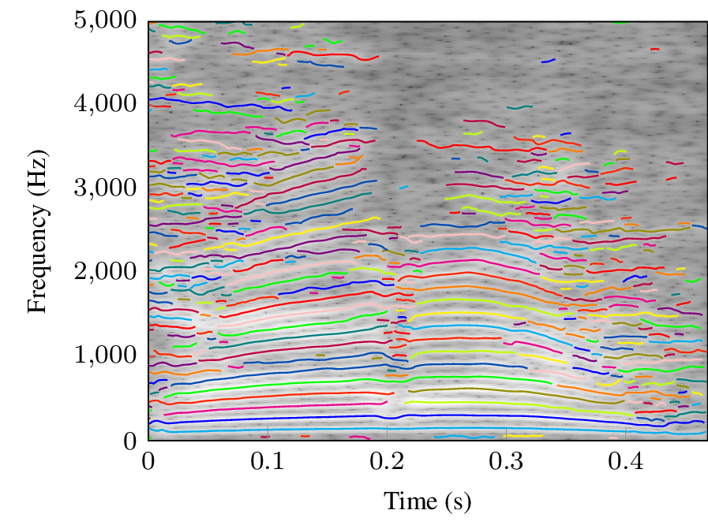

# Fast Partial Tracking

MATLAB implementation of the partial tracking method from the DAFx-18 paper
[*Fast Partial Tracking of Audio with Real-Time Capability through Linear Programming*](https://www.dafx.de/paper-archive/2018/papers/DAFx2018_paper_26.pdf)
(J. Neri and P. Depalle).

<p align="center">
  
  <br>
  <em>Partials tracked in a male voice (/kara/), drawn over its spectrogram. Each color is one partial.</em>
</p>

## Quick start

Open MATLAB in the repository folder and run:

```matlab
jun_demo
```

The demo tracks the partials of `demo_sound.wav`, resynthesizes the signal from them, prints the reconstruction SNR, plays the result, and plots the partials over the spectrogram. Analysis parameters (window length, hop size, peak threshold, model order, cost-function weights) are set at the top of `jun_demo.m`.

## Files

| File | Description |
| --- | --- |
| `jun_demo.m` | Demo: tracking, resynthesis, and plots |
| `jun_track_partials.m` | Partial tracking (peak detection, parameter estimation, frame-to-frame assignment) |
| `jun_synthesize_partials.m` | Additive resynthesis from the tracked partials |
| `jun_write_partials.m`, `jun_read_partials.m` | Write partial data to a binary file after each frame, and read it back |
| `jun_write_sdif.m` | Write partial data to an SDIF text file |
| `utilities/` | Helper functions (windows, peak picking, assignment, plotting) |

## SDIF output

Partial trajectories are also written to a Sound Description Interchange Format (SDIF) text file. To convert it to a binary `.sdif` file (readable by e.g. IRCAM AudioSculpt), build the `tosdif` tool from the [SDIF package](https://sourceforge.net/projects/sdif/files/sdif/) and set `convert_to_sdif = true` in `jun_demo.m`.

## Citation

If you use this code, please cite:

> J. Neri and P. Depalle, "Fast Partial Tracking of Audio with Real-Time Capability through Linear Programming," in *Proceedings of the 21st International Conference on Digital Audio Effects (DAFx-18)*, Aveiro, Portugal, Sep. 2018, pp. 326–333.

```bibtex
@inproceedings{neri2018fast,
  author    = {Neri, Julian and Depalle, Philippe},
  title     = {Fast Partial Tracking of Audio with Real-Time Capability through Linear Programming},
  booktitle = {Proceedings of the 21st International Conference on Digital Audio Effects (DAFx-18)},
  address   = {Aveiro, Portugal},
  pages     = {326--333},
  year      = {2018}
}
```
